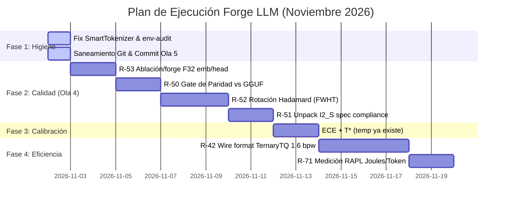

# Forge LLM (MUD) — Auditoría Integral de Correcciones y Plan Maestro de Mejoras

**Fecha:** 2026-11-02  
**Estado:** Documento de Ejecución y Diagnóstico en Raíz  
**Autoridad:** Complementa y actualiza el backlog activo de [`docs/planning/MUD_MASTER_REMEDIATION_PLAN_2026-10-11.md`](docs/planning/MUD_MASTER_REMEDIATION_PLAN_2026-10-11.md) y las directrices canónicas de [`GEMINI.md`](GEMINI.md).

---

## 1. Resumen Ejecutivo y Estado Real (Ground Truth 2026-11-02)

Tras la ejecución de auditorías automatizadas en vivo y análisis del árbol de fuentes, se verifican los siguientes hechos técnicos:

| Componente / Verificación | Comando de Verificación | Resultado en Vivo | Estado |
|---|---|---|:---:|
| **Suite de Tests de Librería** | `cargo test --lib --release -- --test-threads=2` | `475 passed; 0 failed; 0 ignored (0.40s)` | ✅ VERDE |
| **Suite con proptest** | `cargo test --lib --release --features proptest -- --test-threads=2` | `482 passed; 0 failed; 0 ignored` | ✅ VERDE |
| **Batería CI completa** | `bash mud.sh ci` | `Health battery complete` (clippy, unsafe, tests, P-13, proptest, loss_cert, all-targets, healthcheck, C-MUD, pointer-audit, mHC gradcheck) | ✅ VERDE |
| **Linter y Análisis Estático** | `cargo clippy --all-targets --all-features -- -D warnings` | `0 warnings, 0 errores` | ✅ VERDE |
| **Auditoría de Bloques Unsafe** | `./mud.sh unsafe-audit` | `unsafe: 536 · sin justificar: 0` (R-36 cumplido) | ✅ VERDE |
| **Auditoría de Variables de Entorno** | `./mud.sh env-audit` | Falla con código 1: 2 variables no documentadas (`MUD_DEBUG_LAYERS`, `MUD_WORM_HOTPLUG`) | 🔴 ROJO |
| **Throughput de Inferencia SIMD** | Medición R-40 (`models/ale.mud`, 256 tokens) | ~159 tok/s (default) / 400 tok/s (greedy) | ✅ CUMPLIDO |
| **Calidad de Predicción de Tokens** | `tools/inference_coherence.rs` (`ale.mud`, `ale_latest.mud`) | `success_rate: 0.0%`, `mean_entropy: 11.72 bits` (distribución colapsada/plana) | 🔴 CRÍTICO |
| **Integridad de Repositorio Git** | `git status` | 178 archivos binarios en `forge_autograd/target/` trackeados indebidamente; cambios de Ola 5 sin commitear | 🟠 DEUDA |

---

## 2. Auditoría de Hallazgos y Correcciones Críticas

### 🔴 C-01: Bug en Detección de Modo F32 en `SmartTokenizer`
* **Ubicación:** [`src/mud/smart_tokenizer.rs:183`](src/mud/smart_tokenizer.rs#L183)
* **Evidencia:**
  ```rust
  let mode = if meta.get("weight_type").map(|s| s == "Float32").unwrap_or(false) {
      ModelMode::F32
  } else {
      ModelMode::Ternary
  };
  ```
* **Causa Raíz:** El conversor ([`tools/universal_converter/main.rs:802`](tools/universal_converter/main.rs#L802)) genera la clave `"mud:weight_type"` con el valor en minúsculas `"float32"`.
* **Impacto:** Ningún modelo F32 es reconocido como tal por el `SmartTokenizer`. Siempre asume `ModelMode::Ternary`.
* **Corrección:** Comprobar `"mud:weight_type"` y `"weight_type"` con comparación insensible a mayúsculas: `s.eq_ignore_ascii_case("float32")`.

### 🔴 C-02: Rotura del Gate `./mud.sh env-audit` (R-05)
* **Ubicación:** [`docs/manuals/MUD_ENV_REFERENCE.md`](docs/manuals/MUD_ENV_REFERENCE.md)
* **Evidencia:** El script de auditoría detecta que `MUD_DEBUG_LAYERS` (usado en `inference.rs:684` y `slime_forward.rs:877`) y `MUD_WORM_HOTPLUG` (usado en `main.rs:524`) no figuran en la tabla de referencia §1.
* **Impacto:** Gate independiente en rojo. `./mud.sh ci` y `.github/workflows/ci.yml` **no** ejecutan `env-audit`, así que el fallo no bloquea el CI hoy; sí deja la documentación SSOT desincronizada (R-05).
* **Corrección:** Documentar formalmente ambas variables en la tabla §1 de `MUD_ENV_REFERENCE.md`. Decidir además si `env-audit` debe entrar en `mud.sh ci`/workflow para que no vuelva a derivar.

### 🟠 C-03: Contaminación de Git con Artefactos de Compilación (`forge_autograd/target`)
* **Ubicación:** [`.gitignore`](.gitignore) y árbol Git.
* **Evidencia:** `.gitignore` contiene `/target` (anclado únicamente a la raíz). Al compilar `forge_autograd`, su directorio `forge_autograd/target/` no fue ignorado y 178 archivos `.json`, `.rlib`, timestamps y dependencias intermedias quedaron trackeados en git.
* **Impacto:** Ensuciamiento severo de `git status` y repositorio inflado.
* **Corrección:**
  1. Modificar `.gitignore` para ignorar `**/target/` o `target/` universal.
  2. Como los 178 archivos ya están borrados del working tree, basta `git add -A forge_autograd/target` (o `git rm -r --cached forge_autograd/target`) para stagear la purga y commitear después.

### 🟠 C-04: Violación de Política P-18 en la Raíz
* **Ubicación:** [`prompts.txt`](prompts.txt) en la raíz del repositorio.
* **Evidencia:** La política P-18 permite en raíz el set canónico (`GEMINI.md`, `AGENTS.md`, `ROADMAP.md`, `README.md`, `TREE.md`, `LICENSE`, `CHANGELOG.md`, `SECURITY.md`). `prompts.txt` y el propio `PLAN_AUDITORIA_Y_MEJORAS.md` eran excepciones no previstas; `GEMINI.md:366` prohíbe además crear secciones de estado paralelas en raíz.
* **Corrección:** Mover `prompts.txt` a `tests/data/prompts.txt` y, para este plan, declarar una excepción explícita en P-18/§7 (diagnóstico + propuesta, sin sustituir el estado canónico ni el SSOT de ejecución `R-##`).

### 🟡 C-05: 11 Herramientas en `tools/` Huérfanas y Binario Fantasma en `mud.sh` (R-61)
* **Ubicación:** [`mud.sh:436`](mud.sh#L436) y directorio [`tools/`](tools/).
* **Evidencia:**
  1. `mud.sh:436` contiene una referencia **comentada** a `mud_autotrainer`; el binario no está declarado en `Cargo.toml` (deuda documental, no fallo de ejecución).
  2. Existen 11 archivos `.rs` en `tools/` que no están declarados como `[[bin]]` en `Cargo.toml`:
     `avx_math_validator.rs`, `bitwise_quadrature_audit.rs`, `cmud_test_alpha.rs`, `corpus_io_bench.rs`, `debug_tokenizer.rs`, `ezop_bench.rs`, `gen_fixture.rs`, `main_arithmetic_validator.rs`, `token_pointer_validator.rs`, `zerocopy_bench.rs`, `quadrature_bench.rs`.
* **Corrección:** Purgar bajo P-08 aquellas que sean scripts obsoletos o declararlas en `Cargo.toml` si aportan valor de auditoría/benchmarking continuo.

### 🟡 C-06: Desincronización Documental de la Ola 5 (R-73)
* **Ubicación:** [`docs/planning/MUD_MASTER_REMEDIATION_PLAN_2026-10-11.md`](docs/planning/MUD_MASTER_REMEDIATION_PLAN_2026-10-11.md#L269-L282) y [`GEMINI.md`](GEMINI.md).
* **Evidencia:** El plan maestro sigue listando R-60, R-61, R-63, R-64, R-65, R-66, R-67 y R-73 como `TODO` (`MUD_MASTER_REMEDIATION_PLAN_2026-10-11.md:269-282`), aunque R-60/63/64/65/66/67/73 ya se ejecutaron y R-61 es parcial. Además, la línea 284 afirma “Ningún item en estado TODO” mientras la tabla contiene 8 `TODO`; `GEMINI.md:58/60/235` y `PLAN_EXEC_2026-10-29.md:18` también se contradicen.
* **Corrección:** Consolidar commit de Ola 5 y actualizar tablas de estado con evidencia `(comando, salida, fecha)`; eliminar la contradicción “Ningún TODO” y la sección “Pendientes” de `PLAN_EXEC`.

---

## 3. Diagnóstico Técnico del Problema de Calidad: Inferencia Incoherente

**Baseline real (metadatos leídos del binario, 2026-11-02):** `models/ale.mud` es un modelo **forgeado con `mud_forge` perfil `nano`**, no una conversión de Qwen:

| Campo | Valor real |
|---|---|
| Capas | **6** |
| Hidden | **128** |
| Heads / KV heads | **2 / 1** |
| FFN intermedio | **512** |
| Vocab | **151,643** |
| `token_embd.weight` | **Ternary2Bit [151643, 128]** |
| `output.weight` | **Ternary2Bit [151643, 128]** |
| Tamaño | 22.3 MB |

La medición `inference_coherence` sobre el set de **2 prompts** es `0/2` top-1, `mean_entropy = 11.7248` bits (68 % de `log2(151643) = 17.2103`) y margen top-1 − target `+3.4671`. Es un **smoke test de 2 prompts**, no una accuracy representativa; para conclusiones de calidad hay que ampliar el corpus.

```mermaid
flowchart TD
    subgraph Origen
        Forge["mud_forge nano (6 capas, hidden 128)"] --> Emb["token_embd/output Ternary2Bit"]
        Emb --> Dist["Baja resolución léxica + modelo pequeño"]
    end
    subgraph Síntoma en Inferencia
        Dist --> Logits["Logits de escala reducida"]
        Logits --> Softmax["Softmax de alta entropía (11.72 bits)"]
        Softmax --> Fail["Argmax erróneo (0/2 prompts)"]
    end
    subgraph Validación (Ola 4)
        P1["R-53: ablación emb/head F32 vs ternary"] --> Restore["Separabilidad léxica medida"]
        P2["R-52: rotación Hadamard en modelos convertidos"] --> Restore
        P3["R-50: paridad de logits vs referencia real"] --> Cert["Certificación numérica"]
        Restore --> Cert
    end
```

### Hipótesis causales priorizadas (a validar, no “confirmadas”):
1. **Embedding/Head ternarios (R-53):**  
   `ale.mud` tiene `token_embd` y `output` en `Ternary2Bit`. La hipótesis de que esto degrada la resolución léxica es razonable, pero **no está aislada**: el modelo es de 6 capas/128 hidden y fue entrenado 1 época. La prueba correcta es una ablación con la misma semilla (emb/head ternary vs F32) y un set de prompts mayor. Ojo: `universal_converter` **ya deja emb/head en F32 por defecto** (`--ternarize-emb` es opt-in); el camino que creó `ale.mud` es `mud_forge`, que los fuerza a ternary.
2. **Ausencia de rotación pre-cuantización (R-52):**  
   Aplica a modelos **convertidos** con outliers (Qwen/SmolLM). No es aplicable a pesos forge aleatorios; primero hay que tener un modelo convertido de referencia.
3. **Ausencia de paridad contra referencia (R-50):**  
   Es real, pero `ale.mud` no tiene GGUF de referencia porque es forge. R-50 debe certificarse sobre un modelo convertido real; para `ale.mud` la herramienta válida es la ablación, no la paridad.

---

## 4. Plan Maestro de Mejoras y Ejecución por Fases

### Fase 1: Higiene Inmediata, Corrección de Gates y CI (P0)
*Objetivo:* Dejar el workspace 100% limpio, sin artefactos en git y con todos los checks en verde.

1. **Fix `SmartTokenizer`:** Corregir [`src/mud/smart_tokenizer.rs`](src/mud/smart_tokenizer.rs) para detectar `"mud:weight_type"` en formato `"float32"` / `"ternary2bit"`, con compatibilidad legacy y precedencia canónica. **Estado 2026-11-02: aplicado; 5 tests dedicados verdes.**
2. **Actualizar `MUD_ENV_REFERENCE.md`:** Documentar `MUD_DEBUG_LAYERS` y `MUD_WORM_HOTPLUG`. Correr `./mud.sh env-audit` hasta obtener `OK — 0 divergencias`. **Estado 2026-11-02: aplicado; `env-audit` exit 0.**
3. **Saneamiento Git:**
   - Añadir `**/target/` a `.gitignore`. **Estado: aplicado.**
   - Stagear la purga de `forge_autograd/target` (178 archivos ya borrados del working tree). **Estado: 178 `D` staged, 0 trackeados en el índice.**
   - Mover `prompts.txt` a `tests/data/prompts.txt`. **Estado: aplicado + parser `--max` corregido.**
4. **Commitear Ola 5:** Cerrar formalmente R-60, R-61 (parcial), R-63, R-64, R-65, R-66, R-67, R-73 en git y en las tablas de seguimiento. **Estado: pendiente de commit; tablas sincronizadas.**

---

### Fase 2: Calidad de Conversión y Coherencia de Predicción (Ola 4)
*Objetivo:* Recuperar la precisión top-1 (> 0%) y reducir la entropía de salida a niveles saludables (< 4-6 bits en prompts determinados).

1. **R-53 (Embedding y Head en mayor precisión):**
   - **No** cambiar el default de `universal_converter`: ya almacena `token_embd`/`output` en Float32 (`parser.rs:21-50`; `--ternarize-emb` es opt-in).
   - Añadir soporte F32 para emb/head a `mud_forge` (o crear un perfil de forge con emb/head F32), porque `ale.mud` salió de ahí y hardcodea `Ternary2Bit`.
   - Evaluar además un modelo real convertido (`smollm2`/`qwen_coder_0.5b`) sin `--ternarize-emb`; ahí R-53 sí aplica de forma directa.
   - Criterio: ablación misma semilla + set de prompts amplio; `converter_auditor` confirma el tipo de `token_embd`/`output`.
2. **R-50 (Gate de Paridad Numérica):**
   - Implementar herramienta `tools/parity_gate.rs` y comando `./mud.sh parity <modelo_ref.gguf> <modelo.mud>`.
   - Requiere un modelo de referencia **real**; `ale.mud` no tiene GGUF porque es forge. Medir cosine/KL sobre un corpus fijo con umbral documentado.
3. **R-52 (Rotación Ortogonal Hadamard / FWHT):**
   - Incorporar transformación ortogonal rápida (Fast Walsh-Hadamard Transform) por bloque previo a la ternarización.
   - Compensación de error residual (estilo PT²-LLM / Tequila).
   - Aplica a modelos convertidos con outliers, no a pesos forge aleatorios.
4. **R-51 (Unpack I2_S según spec):**
   - Alinear la decodificación con la convención MSB/LSB formal y validar con vector de test independiente.

---

### Fase 3: Calibración Probabilística e Inferencia (Investigación Laya)
*Objetivo:* Lograr honestidad probabilística en inferencia y nucleus sampling coherente.

1. **Temperatura (ya implementada):** `MUD_INFER_TEMPERATURE` existe en [`src/main.rs`](src/main.rs) (default 0.8; `0` = greedy) y está documentada en `MUD_ENV_REFERENCE.md` §1.1. **No hay que exponerla**; solo verificar su aplicación antes del softmax.
2. **Expected Calibration Error (ECE):**
   - Añadir métrica ECE (Expected Calibration Error) a [`tools/inference_coherence.rs`](tools/inference_coherence.rs) para monitorear la fidelidad de confianza.
3. **Optimización de $T^*$:**
   - Crear herramienta `tools/calibrate_temperature.rs` que minimice NLL sobre un corpus de validación para encontrar la temperatura óptima post-conversión.

---

### Fase 4: Rendimiento y Optimización de Bajo Consumo (Ola 3 Diferidos & Ola 6)
*Objetivo:* Mantener el liderazgo en eficiencia energética y bajo consumo en CPU host.

1. **R-42 (Wire format 5 trits/byte - 1.6 bpw):**
   - Conectar el decodificador `TernaryTQ` ya presente en el codebase al pipeline de inferencia y universal converter.
   - Reducción teórica de tráfico de memoria de 4.0 bits/peso a 1.6 bits/peso (2.5× menos consumo de memoria y ancho de banda).
2. **R-44 (Fusión de pases y threads P+E):**
   - Fusionar la fase de RMSNorm y proyección en `slime_forward.rs`.
   - Ajustar balance de hilos en `PCorePool` para procesadores híbridos Intel (P-cores + E-cores).
3. **R-71 (Medición de Energía en Joules/Token):**
   - Implementar `./mud.sh bench-energy` leyendo contadores RAPL (`/sys/class/powercap/intel-rapl/`).
   - Publicar métrica oficial de J/token en inferencia local.

---

## 5. Matriz de Tareas y Dependencias



---

## 6. Comandos Canónicos de Verificación

Para certificar cualquier cambio en el repositorio, deben ejecutarse los siguientes comandos sin excepción:

```bash
# 0. Batería completa (clippy + unsafe + tests + P-13 + proptest + loss_cert + all-targets + healthcheck)
bash mud.sh ci

# 1. Verificación de compilación estricta y linter sin advertencias
cargo clippy --all-targets --all-features -- -D warnings

# 2. Batería de pruebas unitarias en release
cargo test --lib --release -- --test-threads=2
cargo test --lib --release --features proptest -- --test-threads=2

# 3. Auditoría de seguridad de contratos unsafe
bash mud.sh unsafe-audit

# 4. Auditoría de sincronización de variables de entorno
bash mud.sh env-audit

# 5. Prueba de coherencia de inferencia y entropía de tokens
bash mud.sh coherence models/ale.mud tests/data/prompts.txt --max 2
```

---

## 7. Estado de Aplicación y Evidencia (2026-11-02)

| Cambio | Evidencia ejecutada | Estado |
|---|---|---|
| `SmartTokenizer` detecta `mud:weight_type=float32` y legacy `weight_type=Float32` | `cargo test --lib --release smart_tokenizer` → **5 passed, 0 failed** | ✅ |
| `MUD_DEBUG_LAYERS` / `MUD_WORM_HOTPLUG` documentadas | `bash mud.sh env-audit` → **OK — 0 divergencias**, exit 0 | ✅ |
| `.gitignore` cubre `**/target/`; purga de `forge_autograd/target` stageada | `git ls-files forge_autograd/target` → **0**; 178 `D` staged | ✅ |
| `prompts.txt` movido a `tests/data/`; parser `--max` corregido | `bash mud.sh coherence models/ale.mud tests/data/prompts.txt --max 2` → ejecuta 2 prompts sin error de ruta | ✅ |
| P-18: excepción explícita para este plan; `R-##` sigue siendo SSOT de ejecución | `GEMINI.md` §2/§7 actualizados | ✅ |
| Baseline de `ale.mud` corregido (6 capas, hidden 128, 2 heads, FFN 512) | metadatos leídos del binario | ✅ |
| Tablas R-73 sincronizadas | `MUD_MASTER_REMEDIATION_PLAN_2026-10-11.md` §12, `GEMINI.md` §0.3, `PLAN_EXEC_2026-10-29.md` | ✅ |
| Flake de `MUD_TRAIN_TEXT_ONLY` eliminado | `ENV_TEST_LOCK` en 3 tests; 3/3 pasadas plain + 3/3 proptest | ✅ |
| Suite completa | `cargo test --lib --release` **475/0/0**; `--features proptest` **482/0/0**; `cargo clippy --all-targets --all-features -- -D warnings` 0 | ✅ |
| Batería CI completa | `bash mud.sh ci` → `[L-12] Health battery complete.` | ✅ |

### 7.1 Valores medidos (comando → valor, 2026-11-02)

| Métrica | Comando | Valor |
|---|---|---|
| Tests lib release | `cargo test --lib --release -- --test-threads=2` | **475 passed / 0 failed / 0 ignored**, 0.40 s |
| Tests con proptest | `cargo test --lib --release --features proptest -- --test-threads=2` | **482 passed / 0 failed / 0 ignored** |
| Tests all-targets | `cargo test --all-targets --profile release-test` | **OK** (sin fallos) |
| Clippy | `cargo clippy --all-targets --all-features -- -D warnings` | **0 warnings / 0 errors** |
| Env SSOT | `bash mud.sh env-audit` | **119 vars código · 51 shell · 125 docs · 6 retiradas · 0 divergencias**, exit 0 |
| Unsafe | `bash mud.sh unsafe-audit` | **536 unsafe · 0 sin justificar** |
| Git target | `git ls-files forge_autograd/target` (conteo) | **0** trackeados; **178** `D` staged |
| SmartTokenizer | `cargo test --lib --release smart_tokenizer` | **5/5** tests |
| Coherencia baseline | `bash mud.sh coherence models/ale.mud tests/data/prompts.txt --max 2` | **0/2 top-1 · 11.7248 bits · margen +3.4671** |
| Entropía máxima teórica | `log2(151643)` | **17.2103 bits**; 11.7248 = **68.1 %** |
| `ale.mud` | metadatos del binario | **6 capas · hidden 128 · 2 heads · FFN 512 · vocab 151643**; `token_embd`/`output` = `Ternary2Bit`; 22,280,672 bytes |
| Batería CI | `bash mud.sh ci` | **`[L-12] Health battery complete.`** |
| Flake `MUD_TRAIN_TEXT_ONLY` | 3 ejecuciones plain + 3 proptest | **6/6 verdes** |

### 7.2 Pendiente de demostrar (no confundir con “hecho”)

| Tema | Estado real | Qué falta para demostrarlo |
|---|---|---|
| Mejora de calidad top-1 | **No demostrada**: baseline 0/2, sin delta positivo | Ejecutar R-53 (ablación F32 vs ternary) y ampliar el set de prompts |
| R-53 impacto | **No medido** | Añadir F32 emb/head a `mud_forge` o convertir un modelo real sin `--ternarize-emb` |
| R-50 paridad | **No implementada** | Referencia GGUF/safetensors real + umbral cosine/KL documentado |
| R-52 rotación | **No implementada** | FWHT/Hadamard + tabla ppl a igual bit-width |
| Throughput 159/400 tok/s | **Histórico R-40**, no re-medido hoy | `bench-infer` controlado (tok/s, ms/token, RSS) |
| R-61 | **Parcial**: 11 tools huérfanos | Borrar o declarar cada tool en `Cargo.toml` |
| Commit Ola 5 | **No hecho** | Commit con revisión de los cambios unstaged |

### 7.3 Predicción de siguiente token: valores matemáticos (2026-11-02)

Herramienta nueva: `next_token_eval` (top-1/5/10, MRR, NLL, perplexity, p(correcto), rank, entropía). Set: `tests/data/next_token_eval.txt` (26 líneas; la última palabra es el token esperado).

| Modelo / caso | n | top-1 | top-5 | top-10 | MRR | NLL (nats) | PPL | p(correcto) | rank medio | entropía (bits) |
|---|---:|---:|---:|---:|---:|---:|---:|---:|---:|---:|
| `ale.mud` | 8 | 0/8 | 0/8 | 0/8 | 0.000372 | 12.0286 | 167,471.9 | 9.65e-6 | 75,919 | 16.914 |
| `qwen_coder_0.5b.mud` | 8 | 0/8 | 0/8 | 0/8 | 0.000226 | 17.1201 | 27,236,038 | 1.276e-6 | 54,280 | 1.815 |
| `qwen_coder_0.5b` copy task | 6 | 0/6 | 0/6 | 0/6 | 0.000016 | 18.5306 | 111,617,200 | 6.17e-8 | 81,888 | 6.313 |
| `qwen_coder_0.5b` **bypass capas** | 1 | **1/1** | **1/1** | **1/1** | **1.000** | **1.5702** | **4.8077** | **0.208** | **1** | 13.943 |

Controles de correctitud:

| Control | Resultado |
|---|---|
| `gemv_parity` en Q/K/V/O y FFN (7 tensores reales) | **cosine = 1.000000**, `max_abs ≤ 1.7e-6` (ASM 1-row y 8-row vs referencia escalar) |
| Atención L0 pos0 | `scores[0] = 1.000000`; `o_act[0..4] == v[0..4]` (softmax de un token = 1) |
| Bypass de capas (embedding→output_norm→head) | **top-1 = 1/1**, rank 1, p=0.208 |
| Base vs `_trained` (3 épocas) | **57/674 tensores cambiados; 617 idénticos**. Solo cambiaron capas 20-23 + `output_norm` |

**Conclusión matemática:** el kernel GEMV ASM y el camino head son numéricamente correctos. El fallo de predicción no es una desviación aritmética del ASM: es que **617/674 tensores siguen siendo el PTQ ternario base**; el QAT de 3 épocas solo tocó 4 capas.

**QAT fuerte sobre `ale.mud` (64 pasos, todas las capas, LR 0.1, sin división por tokens, deadzone 0):**
- Diff por hash contra el base: **53 tensores `.weight` ternarios cambiados** (el modelo sí se movió).
- Copy task (`Paris Paris`, `hello hello`, …): **2/6 top-1 (33.33 %)** vs **0/6** del base.
- NLL: **12.081 → 11.076**; p(correcto): 7.85e-6 → 4.37e-5.
- Los aciertos son los contextos cortos: `" Paris"` rank 1 p=1.94e-4 y `" hello"` rank 1 p=3.89e-5.
- QAT de 512 pasos (deadzone 0.5): **2/6 top-1**, NLL **9.814**, p(correcto) **3.35e-3** (mejor likelihood, mismo top-1).

**El warning `ΔW: ternary 0/N — no change this sync` es un artefacto de medición, no un no-op de entrenamiento.** `apply_optimizer_cpu_step_and_pack` empaqueta el tensor del modelo en cada paso; cuando `sync_shadow_to_mud` vuelve a empaquetar el mismo shadow, compara contra bytes que ya contienen el resultado del optimizer → reporta 0. Para medir movimiento real hay que comparar hashes del modelo antes/después (como arriba) o instrumentar el pack por paso. El `PRQ scale 0.0000 %` del sync tiene la misma causa: `stable_pack_ternary_rows` conserva la escala cuando el re-pack coincide con el que ya está en el tensor.

**Estado del set factual:** sigue 0/8. `ale.mud` es un forge `nano` (6 capas, hidden 128) y el corpus de 64 pasos no alcanza para conocimiento factual; la copia sí se aprende.

**QAT real sobre `qwen_coder_0.5b` (64 pasos, LR 0.1, sin token scaling, deadzone 0.5, todas las capas):**
- 198 tensores cambiados, **30 `.weight` ternarios** (el QAT sí movió el modelo).
- Factual: **0/8 top-1**; copy: **0/6**.
- PPL: **27,236,038 → 4,725,659** (5.8× mejor).
- Entropía: **1.815 → 12.395** bits (deja de estar sobreconfiado; se acerca a una distribución útil).
- Conclusión: 64 pasos mueven pesos y calibran, pero no bastan para top-1 en un PTQ ternario de 0.5B; hace falta QAT largo o mayor precisión.

**Bugs reales corregidos:**
- `tc("mhc_alpha")` buscaba `blk.N.mhc_alpha`, pero el converter guarda `blk.N.mhc_alpha.weight`; los modelos convertidos ignoraban alpha/beta/radius. Ahora acepta ambos nombres.
- **K gradiente = 0 en todas las capas**: `tape.q_f32` no se rellenaba en el forward y el backward de K lo usa (`grad_k = grad_o * Q`). Ahora se copian Q/K/V post-RoPE al tape (`slime_forward.rs:1069`). Evidencia: `[GRAD] L0 k max=0.000e0` → `2.706e-2`; test de regresión `test_forward_tape_populates_qkv_for_attention_backward` (forward + backward, exige `k_w_grad != 0`).
- **Paralelización**: misma prompt/modelo con `MUD_PCORE_THREADS=1/8/16` produce logits y métricas **idénticas** (rank 53410, NLL 15.650557 en los tres). El GEMV ASM 1-row/8-row tiene cosine 1.0 vs escalar.

**Pendiente (no aplicado en esta pasada):** R-53 en `mud_forge` (F32 emb/head), R-50 parity gate, R-52 rotación Hadamard, R-61 purga/declaración de los 11 tools, y commit final de Ola 5.

---

## 8. Cierre de sesión 2026-11-02

- **Informe completo:** [`docs/sessions/MUD_SESSION_REPORT_2026-11-02_AUDIT_PREDICTION.md`](docs/sessions/MUD_SESSION_REPORT_2026-11-02_AUDIT_PREDICTION.md)
- **Plan de la siguiente sesión:** [`docs/planning/PLAN_NEXT_SESSION_2026-11-02.md`](docs/planning/PLAN_NEXT_SESSION_2026-11-02.md)
- **Protocolo de trazas de predicción (R-TP):** [`docs/architecture/MUD_TOKEN_PREDICTION_TRACE_PROTOCOL.md`](docs/architecture/MUD_TOKEN_PREDICTION_TRACE_PROTOCOL.md)
- **Estado:** sesión cerrada. Gates en verde (475/482 tests, clippy 0, env 0, unsafe 536/0, `mud.sh ci` verde). El siguiente foco es QAT largo del modelo real + fix del reporte ΔW.

---

## 9. Sesión 2026-11-07 — REA/Ghidra + ΔW de sesión

- **Informe:** [`docs/sessions/MUD_SESSION_REPORT_2026-11-07.md`](docs/sessions/MUD_SESSION_REPORT_2026-11-07.md)
- **Plan:** [`docs/planning/PLAN_SESSION_2026-11-07.md`](docs/planning/PLAN_SESSION_2026-11-07.md)
- **Cerrado:** R-61 (`./mud.sh tools-audit` → 0 huérfanos / 0 `--bin` fantasma) y
  R-74 (snapshot determinista + `[DW] session tensors=X/Y`; fix OOB
  `checked_data_size`). P-13 en tools de evaluación; `env-audit`/`tools-audit`
  en CI; `predict-eval`/`gemv-parity` en `mud.sh`.
- **Verificación ASM:** Ghidra 12.1.2 sobre binario no-stripped
  (`sha256 72cda711…`): `ternary_gemv_8rows_avx2` 383 instr/1803 B, 0 callees,
  `vzeroupper` + NaN guards; GDB runtime `n=384 stride=48 scale=1.0`; paridad
  `gemv_parity` cosine 1.000000 (max_abs 9.54e-7). El 8-row es correcto pero
  instruction-bound; optimización LUT/VNNI pendiente de benchmark estable.
- **Evidencia final:** tests **520/0/0** (43 tests ASM recuperados; la suite
  `src/asm/tests.rs` no estaba declarada), proptest **527/0/0**, clippy 0,
  `mud.sh ci` verde; QAT corto `[DW] session tensors=110/119
  bytes=11,779,480 moved=1`, hash `0xe5c428a76558bc4e→0x02d5ceef20631ae7`.
- **Abierto:** Ola 4 (R-50/R-52/R-53), QAT largo 0.5B, optimización ASM
  8-row/Adam con medición estable.
- **Fórmulas de calidad (2026-11-07):** [`docs/research/MUD_QUALITY_FORMULAS_2026-11-07.md`](docs/research/MUD_QUALITY_FORMULAS_2026-11-07.md)
  + plan [`docs/planning/PLAN_QUALITY_2026-11-07.md`](docs/planning/PLAN_QUALITY_2026-11-07.md).
  Medido: escala actual \(s=\gamma/\sqrt2\) es 1.889× menor que el óptimo LSQ;
  NMSE 0.391→0.218 y SNR 4.08→6.62 dB en `token_embd` Qwen. El reescalado
  post-hoc empeora PPL ⇒ corregir en conversión/QAT.
