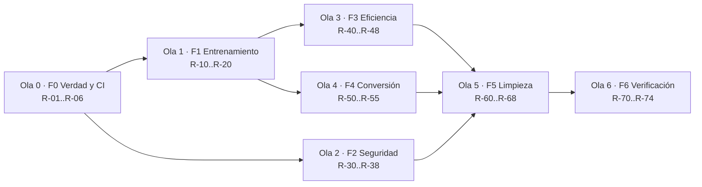

# MUD — Plan Maestro de Correcciones, Limpieza y Mejoras

> # 🥇 PRIORIDAD 0 — BACKLOG ACTIVO
>
> Este documento es la **prioridad 0 del proyecto** (2026-10-11) y sustituye a todos los backlogs anteriores mientras haya ítems `R-##` abiertos. Registrado en `GEMINI.md` (jerarquía de documentos + §6.2), `AGENTS.md` (*last sync* + ledger), `ROADMAP.md` y `docs/manuals/LAUNCH_COUNTDOWN.md`.
>
> **Orden de trabajo obligatorio:** Ola 0 → (Ola 1 ∥ Ola 2) → Ola 3 → Ola 4 → Ola 5 → Ola 6.
> **Nada se marca hecho sin evidencia ejecutada** `(comando, salida, fecha)`.
> **Congelados** hasta cerrar la Ola 1: `docs/research/MUD_IMPROVEMENTS_POST_AE.md`, `docs/research/MUD_GAP_ANALYSIS_POST_L15.md`, `docs/manuals/LAUNCH_COUNTDOWN.md` (board anterior), y cualquier ítem histórico `L-##`/`F#`/`Sprint #`.

**Fecha:** 2026-10-11 · **Origen:** [`docs/audits/MUD_AUDIT_2026-10-11_LOW_COMPUTE.md`](../audits/MUD_AUDIT_2026-10-11_LOW_COMPUTE.md) (auditoría completa con evidencia `file:line` y mediciones en vivo)
**Rol:** SSOT de ejecución. `GEMINI.md` sigue siendo SSOT de políticas/estado; este plan **es** el backlog activo (`R-##`) hasta que `GEMINI §6.2` diga otra cosa.
**Regla de oro:** ningún ítem se marca hecho sin **evidencia ejecutada** (comando + salida), no por inspección.

---

## 0. Principios y guardrails

**No negociables mientras se ejecuta este plan**

1. **Verdad primero.** El baseline (F0) va antes que cualquier optimización. Un CI rojo es el estado correcto hasta que el código esté bien.
2. **Nada de shims.** Se corrige o se borra (P-08). No se deja código muerto "por si acaso", no se añaden `#[allow(dead_code)]` como almacén.
3. **Un solo camino por concepto.** Una deadzone ternaria, una convención de empaquetado, un tokenizer, una forma de validar metadata (P-13: metadata o error).
4. **Fail-fast** (P-17): entrada inválida ⇒ `Result::Err` con mensaje, nunca panic/OOB/silencio.
5. **Zero-alloc en hot path** (P-01) y punteros crudos donde toque (P-00), pero **corrección numérica > micro-optimización**: no se vectoriza nada que esté mal.
6. **Cada cambio de comportamiento trae test que falla antes y pasa después** (P-09), y un test permanente sólo si detecta un bug visible al consumidor.
7. **Medir antes de afirmar.** Rendimiento/energía se documentan con número reproducible (bin + comando). Prohibido "COMPLETADO" sin ejecución (origen de la mitad de los hallazgos de la auditoría).

**No objetivos (fuera de alcance de este plan)**

* Entrenar un modelo nuevo mejor (escalado de datos/arquitectura) — depende de F1.
* Migrar a GPU dedicada o reescribir el motor en otro lenguaje.
* Publicar/marketing. Este plan sólo restaura **verdad, corrección y eficiencia**.

---

## 1. Baseline congelado (2026-10-11)

| Comando | Resultado | Uso |
|---|---|---|
| `cargo clippy --all-targets` | 0 warnings ✅ | se mantiene como gate |
| `cargo test --lib --release` | **459 pass / 0 fail / 2 ignored** ✅ | UB fenwick purgado (R-03, 2026-10-11) |
| `cargo test --lib` (debug) | 459 pass ✅ | (2 tests de batch4/batch8 eliminados) |
| `./mud.sh ci` | debug + `clippy --lib` | debe pasar a `--all-targets` + release + `--all-features` |
| Inferencia `models/ale.mud` | ~46 tok/s (22 ms/token), salida incoherente | métrica de partida para F3 |
| `output.weight` vs checkpoint | valores idénticos (head no entrenada) | prueba de F1-01 |
| CI remoto | workflow inválido → nunca corre | F0-01 |

**Comandos de referencia** (guardar en `mud.sh ci`):

```bash
cargo clippy --all-targets --all-features -- -D warnings
cargo test --lib --release -- --test-threads=2
cargo test --all-targets --release            # incluye bins/integration
cargo +nightly miri test --lib -- kv_compressed fenwick mud::mod --test-threads=1
cargo build --release --all-targets
actionlint .github/workflows/ci.yml           # o equivalente en CI
```

---

## 2. F0 — Verdad, CI y trazabilidad (bloquea todo lo demás)

> Sin esto, cada corrección posterior es invisible o se revierte sola.

| ID | Sev | Evidencia | Acción | Criterio de aceptación | Esf. |
|---|---|---|---|---|---|
| **R-01** | 🔴 | `.github/workflows/ci.yml:76-88` (`on:` dentro del job `nightly-cert-loss`; guard `github.repository == 'ale/proyectos/forge_llm'`) | Mover el `schedule` a la raíz (`on: {push, pull_request, schedule, workflow_dispatch}`) y usar el slug real (`washaka81/mud`); añadir `workflow_dispatch` | `actionlint` limpio; el job aparece en la pestaña Actions de un push de prueba | 0.5 d |
| **R-02** | 🔴 | `./mud.sh ci:513` corre sólo `cargo test --lib` (debug) | `ci` pasa a: `clippy --all-targets --all-features -D warnings`, `test --lib --release`, `test --all-targets`, `build --release --all-targets` | `./mud.sh ci` **falla** hoy y pasa tras F0-03/F1 | 0.5 d |
| **R-03** | 🔴 | `fenwick.rs:307-312`: `_mm256_storeu_ps(result_arr.as_ptr() as *mut f32, …)` sobre binding inmutable → UB, ceros con `-O` | Reescribir con `let mut result_arr = [0.0f32; 8];` (o extraer por `_mm256_extractf128_ps` + `_mm_cvtss_f32` sin store), **o borrar** `prefix_sum_batch4_avx2`/`batch8_avx2` (0 llamadores, P-08) | `cargo test --lib --release` verde; si se conserva, test AVX2-vs-escalar en **release** | 0.5 d |
| **R-04** | 🟠 | Repo sin `.git` (`fatal: no es un repositorio git`) | Inicializar git (o `git init` + primer commit del árbol actual) y `.gitignore` de artefactos (logs, `target/`, `.spv` generados) | `git status` limpio tras commit; el CI puede clonar | 0.5 d |
| **R-05** | 🟠 | 9 env vars documentadas y ausentes; 14 presentes sin documentar | Regenerar la tabla de env vars desde el código (`grep -rhoE 'MUD_[A-Z0-9_]+' src tools \| sort -u`) y publicarla en `docs/manuals/MUD_ENV_REFERENCE.md`; corregir `GEMINI`/`AGENTS`/`ROADMAP` | 0 divergencias (script de comprobación en `mud.sh env-audit`) | 1 d |
| **R-06** | 🟡 | `docs/audits/MUD_AUDIT_LATEST.md` apunta a V38 (2026-07-24) | Actualizar el puntero a la auditoría 2026-10-11 + este plan | Enlaces válidos | 0.2 d |

---

## 3. F1 — Correctitud del entrenamiento (el loss debe bajar)

> **Definición de éxito de la fase:** `./mud.sh cert-loss <modelo>` con loss que **cae monótonamente** en ≥ 40 chunks y `output.weight` (o la cabeza usada en inferencia) **cambiando** entre checkpoint y base.

| ID | Sev | Evidencia | Acción | Criterio de aceptación | Esf. |
|---|---|---|---|---|---|
| **R-10** | 🔴 | `train_step.rs:160` usa `token_embd.weight` como clasificador; `inference.rs:395`/`main.rs:288` usan `output.weight`, que `checkpoint.rs` **nunca escribe** (valores idénticos base↔checkpoint) | Unificar la cabeza: (a) `sync_shadow_to_mud` sincroniza `output.weight` + `output.prq_scale` desde la shadow que el trainer usa, **o** (b) el trainer entrena/lee `output.weight` cuando existe (y `token_embd` sólo cuando es *tied*). Decidir por metadata (`tie_word_embeddings`) y hacerlo explícito | Test: tras N chunks, `output.weight` de-cuantizado difiere del base; inferencia refleja el cambio | 2-3 d |
| **R-11** | 🔴 | Forward `silu(gate)·up` (`slime_forward.rs:613-637`) vs backward ReLU² (`slime_backward.rs:1109-1170`, `ezop.rs:358`) | Implementar `silu_backward` (AVX2 + escalar) y usarlo en las dos rutas (ternaria y F32); borrar `relu2_backward_avx2` o dejarlo sólo si el forward usa ReLU² | `test_silu_ffn_backward_matches_finite_diff` verde (g y u, varios signos) | 1 d |
| **R-12** | 🔴 | mHC backward omite `alpha` y `(1-gate)·beta` (`slime_backward.rs` kinetic-spring loop, rutas ternaria `:1053-1066` + F32 `:628-642`) | `mhc_activation_backward[_avx2]` en `ezop.rs` (gate=sigmoid(v_jepa) vía `sigmoid_vec_local`, AVX2 8-f32/iter + scalar fallback, P-01 cero-alloc, P-17 NaN→0.5); `grad_out=grad_in·alpha`, `grad_branch=(grad_in+kinetic)·(1-gate)·beta`; `kinetic_grad` preservado. Ambas rutas llaman al dispatcher. `test_mhc_activation_backward_matches_reference` (alpha=0.85/beta=1.2/gate≠0.5, rutas mHC + base null) ✅ | 1 d |
| R-13 | 🔴 | Deadzone 0.7·s (conversor) vs 0.5·s (checkpoint/alignment) | `TERNARY_DEADZONE=0.7` SSOT en `constants.rs`; `alignment.rs:250` 0.5→`TERNARY_DEADZONE`; `quantizer.rs:125` hardcode→SSOT; helpers `checkpoint.rs` 0.5→`TERNARY_DEADZONE`. `ldt_micro` fuera de scope (lattice latente ≠ pack). | `test_ternary_deadzone_unified_boundary` + `test_pack_ternary_idempotent` ✅; `cargo test --lib --release -- --test-threads=2` 466/0/2 | 1 d |
| **R-14** | 🔴 | Deriva de escala: `s ← absmean(shadow)·1/√2` en cada save (`checkpoint.rs:203-208, 676-681`) ⇒ ×0.52 por sesión, sin punto fijo; `token_embd.prq_scale` 0.740→0.414→0.334 | Recalcular la escala **sólo** si el modelo realmente se movió; derivarla del **original** (no de la shadow re-escalada); fijar un punto fijo (p. ej. `s` invariante salvo `ΔW` real) y clamp de banda | Test: 5 ciclos save/load sin entrenar ⇒ `prq_scale` y valores de-cuantizados estables (±1e-6) | 2 d |
| **R-15** | 🟠 | 88 % de bytes cambian con valores idénticos entre base y checkpoint ⇒ el layout de bytes no es estable | Hacer `pack_ternary_into` **determinista** y con una sola convención (misma que el conversor); test de round-trip bit-exacto | `hash_trained_weights` refleja cambios reales; test: pack→unpack→pack ⇒ bytes idénticos | 1 d |
| **R-16** | 🟠 | Backward omite `scale_up` del forward (`train_step.rs:654` vs `:665`) | Unificar el factor de escala (una expresión, documentada) forward/backward | Test finite-diff del gradiente del head con `scale_up ≠ 1` | 1 d |
| **R-17** | 🟠 | `grad_norm` observado 0.08-0.27 « clip 1.0; el clip sólo aplica al gradiente de activación | Clipping global sobre **todos** los tensores (norma global) + log de `clip_coef` real en `[TELEM]` | Test: gradiente artificial grande ⇒ `clip_coef < 1` y norma post-clip == clip | 1 d |
| **R-18** | 🟠 | Adam con L2 acoplado dentro del gradiente (`adam_step.s:97-99`, `train_step.rs:1048`) | Decoupled weight decay (AdamW real) o eliminar el WD; documentar | Test: con `wd=0.01, g=0` el peso no se mueve | 0.5 d |
| **R-19** | 🟠 | Loss por encima de `ln(64)=4.159` en todos los logs; `conf_pct` 0.11-0.50 % | Arreglar la función de score (renormalización coherente target/negativos, mismo preprocesado para ambos) y verificar con un batch sintético separable (loss → 0) | `test_sampled_softmax_separable_batch`: loss < 0.1 en datos separables | 1-2 d |
| **R-20** | 🟡 | `chunked_muon_step` stride incorrecto en el último chunk; ruta `scales_only` escribe PRQ ×√2 | Corregir stride (`div_ceil` + resto) y el factor √2; tests de equivalencia chunk vs no-chunk | Tests verdes con `cols` no múltiplo de chunk | 1 d |

---

## 4. F2 — Seguridad y robustez de entrada

> Amenaza real: `.mud`/`.gguf` es entrada de usuario (descarga, conversión). Hoy puede producir OOB read y OOM.

| ID | Sev | Evidencia | Acción | Criterio de aceptación | Esf. |
|---|---|---|---|---|---|
| **R-30** | 🔴 | `inference.rs:350-433`, `main.rs:229-323`: longitudes `from_raw_parts` derivadas de metadata sin cotejo con `tensor.shape` | Validación obligatoria post-load: cada tensor contra las dims declaradas (`token_embd == [vocab,hidden]`, `blk.N.attn_q == [n_heads*head_dim,hidden]`, …) con `checked_mul`; **toda** longitud de slice se deriva del shape validado, nunca de metadata | Proptest: header válido + dims incoherentes ⇒ `Err`, sin panic/OOB | 2 d |
| **R-31** | 🔴 | `mod.rs:618-635`: `product::<usize>()` y `ptr_offset + expected_bytes` sin `checked_*` (release sin overflow-checks) | `checked_mul`/`checked_add` en cadena; cap de magnitud por dim (p. ej. `<= 1<<32`) además del rank | Proptest con dims `usize::MAX` ⇒ `Err` (no wrap, no OOB) | 1 d |
| **R-32** | 🟠 | `gguf/mod.rs:91-190, 264-296`: parser sin cotas (counts, longitudes, `Vec::with_capacity(n)`, recursión, `data_ptr`) | Reusar caps SEC-H1 + bounds en cada slice + `checked_add` para offsets + límite de profundidad/tamaño en arrays anidados | Proptest GGUF (activar la feature) verde; sin panic con ficheros truncados | 1-2 d |
| **R-33** | 🟡 | `mod.rs:880-918`: `ecc_verify_all` lee la paridad con el conteo del tensor base | Validar `data_size(ecc) >= ceil(prod(base.shape)/8)`; usar `get(..)` con error | Test con ECC diminuta ⇒ `Err` | 0.5 d |
| **R-34** | 🟡 | `worm.rs:282-293`: `from_raw_parts` f32 sin comprobar `t_type` ni shape | Derivar `vocab/hidden` del shape del tensor y exigir `Float32` (o decodificar ternario); `get()` + `None` | Test con tensor ternario ⇒ `None` | 0.5 d |
| **R-35** | 🟡 | `gemv_gpu.rs:263` `n_in/8` (floor) y `ternary_gemv.s` `.leftover8` (procesa 8 con resto 1..7) | `div_ceil` + cola 1..7 explícita (asm o escalar) + `debug_assert!(n_in % 8 == 0)` en la frontera FFI | Test con `n_in = 8k+1..7`: resultado igual al escalar, sin over-read (miri/ASAN) | 1 d |
| **R-36** | 🟠 | 19 `unsafe` sin `// SAFETY:` (mod.rs 5, ash_backend 10, kv_compressed 2, ecc 1, worm 1) | Añadir SAFETY correctos (no decorativos) y un lint/check en CI que cuente `unsafe` sin SAFETY adyacente | `mud.sh unsafe-audit` = 0 sin comentario | 1 d |
| **R-37** | 🟠 | `--features unsafe-rce/unsafe-cli` reintroducen `rustc`/`bash -c`; `skills/data_analysis.rs` lee cualquier `.csv` de texto generado | Documentar el riesgo **estructuralmente** (no "0 RCE"), gatear por build explícito, y confinar lecturas a un workspace root | `SECURITY.md` corregido; test: path fuera del root ⇒ `Err` | 1 d |
| **R-38** | 🟡 | `workspace_agent.rs:92-134`: symlink colgante escapa del root | `symlink_metadata` + `O_NOFOLLOW` (o `openat2 RESOLVE_BENEATH`) | Test con symlink colgante ⇒ `Err` | 0.5 d |

---

## 5. F3 — Eficiencia de inferencia (bajo consumo real)

> Objetivo de fase: **≥ 3× tok/s** en `models/ale.mud` y **≥ 2× en la clase 2B**, medido con `mud.sh bench-infer`, sin regresión de calidad.

| ID | Sev | Evidencia | Acción | Criterio de aceptación | Esf. |
|---|---|---|---|---|---|
| **R-40** | 🔴 | `main.rs:616` + `asm/lm_head.s` hacen el head en **f32 denso** (77.6 MB/token en `ale.mud`; ~99 % del tráfico de pesos) y **single-thread** | LM head ternario: kernel de filas batcheadas (4/8) sobre ELUT + `PCorePool` + escala PRQ por fila; sin materializar f32 | ≥ 3× tok/s; test kernel-vs-escalar; RSS sin los 77.6 MB | 3 d |
| **R-41** | 🟠 | `main.rs:226, 292`: `emb_f32` + `out_f32_owned` = 155 MB para un `.mud` de 22 MB | De-cuantizar la **fila** necesaria (`dequantize_ternary_row`) en el lookup de embedding; no construir matrices f32 | RSS de inferencia < 40 MB en `ale.mud` (medir con `/usr/bin/time -v`) | 1-2 d |
| **R-42** | 🟠 | Formato = 4 bits/peso (`mod.rs:145`) = 2.52× la entropía ternaria; `TQ1_0`/`PTQ1_0` logran 1.67-1.69 bpw (5 trits/byte) | Nuevo tipo de tensor `TernaryTQ` (base-3, 5 trits/byte) + decodificador + kernels; migrar conversor y trainer; mantener lectura del formato antiguo sólo para migración | Bytes/peso ≤ 1.7; equivalencia bit-exacta con el decode ELUT en un test de corpus; ~2.5× menos tráfico | 4-6 d |
| **R-43** | 🟠 | 4 round-trips `f32→i8→f32` por capa sin beneficio (`slime_forward.rs:679-709, 771-832, 1254-1274, 1383-1410`) | Eliminarlos (pasar f32 directo al GEMV) **o** completar W2A8 real (kernel que consuma i8). No dejar el híbrido | Paridad numérica con el forward actual; menos pases medidos en `perf` | 2 d |
| **R-44** | 🟡 | `PCORE_THREADS_CAP = 8` (8 E-cores ociosos); fases norm/attn/JEPA seriales; false sharing en slots del pool | Política de hilos configurable (P+E) + fusionar pases + padding/alineado de slots; medir con `MUD_PCORE_THREADS` 8/12/16 | Tabla de tok/s por configuración; elegir el óptimo y documentarlo | 2 d |
| **R-45** | 🟡 | Residual en f16 por capa (`slime.rs:33-77`); guard de overflow comprueba f32, no rango f16 | Ablación f32 vs f16 del residual (env) + clamp real a rango f16 (±65504) o promoción a f32 en la ruta crítica | Ablación medida (ppl/tok-s) documentada; sin Inf posible | 1-2 d |
| **R-46** | 🟡 | KV en f32 por defecto; sin cuantización sub-8-bit | KV 4/2-bit por bloque (MiniKV/KVQuant-style) tras R-40; default medido | -50 % RAM de KV a 4k ctx sin pérdida medible en `cert-loss` | 2-3 d |
| **R-47** | 🟡 | mpGEMM por bit-twiddling (`vpsrlvd/vpcmpeqd/vpand`) | Prototipo **LUT-based** (T-MAC style) en un kernel y benchmark A/B contra el actual | `asm_kernel_bench` con columna LUT vs actual; adoptar si gana | 3 d |
| **R-48** | 🟡 | `MUD_GPU_GEMV` default `0` en `mud.sh:48` (docs dicen `auto`) | Alinear código y docs; dejar `auto` real con el calibrador o documentar `0` como default | Doc == `mud.sh`; decisión escrita | 0.2 d |

---

## 6. F4 — Calidad de conversión y cuantización

| ID | Sev | Evidencia | Acción | Criterio de aceptación | Esf. |
|---|---|---|---|---|---|
| **R-50** | 🔴 | No existe test de paridad contra el modelo original; `conversion_verifier.rs` reimplementa el mismo decode que el conversor (auto-consistente) | Gate de paridad: perplejidad/logits del `.mud` vs referencia (BF16/GGUF) sobre un corpus fijo, con umbral; falla el build si empeora | `mud.sh parity <ref> <mud>` con umbral documentado; test en CI con modelo pequeño versionado | 2-3 d |
| **R-51** | 🟠 | `quantizer.rs:57-71`: unpack U8/I2_S LSB-first y 4 valores repartidos entre filas; la spec oficial (y `BITNET_SPEC.md:40`) dice MSB-first y 4 consecutivos en la fila | Corregir el unpack a la convención documentada **y** añadir vector de test con bytes conocidos (`0b00_01_10_11` → `[-1,0,+1,x]` en orden); idem `to_f32_vec` y el verifier (que debe ser **independiente**) | Test de vector fijo; conversión de un tensor sintético con valores conocidos ⇒ paridad exacta | 1-2 d |
| **R-52** | 🟠 | `quantizer.rs:125`: absmean por fila + umbral fijo, sin rotación ni compensación | Rotación FWHT/Hadamard antes de ternarizar (QuIP#/ITQ3_S/TurboQuant) como opción del conversor, y PTQ con compensación de error (PT²-LLM/Tequila-style) | Tabla ppl por método a igual bit-width; adoptar el ganador | 3-5 d |
| **R-53** | 🟠 | `ale.mud` ternariza `token_embd` **y** `output`; `BITNET_SPEC.md:29` recomienda mayor precisión | Default: embeddings/head en 8-bit (o f16) con opción `--ternarize-emb` explícita; medir impacto | ppl de un modelo ternario con emb 8-bit vs ternario puro | 1-2 d |
| **R-54** | 🟡 | Paleta de códigos: sólo 2 de 16 estados usados | Evaluar Signed-Zero Ternary (4º estado) dentro del mismo nibble | Test de calidad a igual tamaño | 1 d |
| **R-55** | 🟡 | `CellV5`/`SlimeX` sin efecto medible en el hot path | Medir (bench) y decidir: wirear o purgar (P-08) | Decisión documentada con números | 1 d |

---

## 7. F5 — Limpieza y deuda estructural

| ID | Sev | Evidencia | Acción | Criterio de aceptación | Esf. |
|---|---|---|---|---|---|
| **R-60** | 🟠 | `src/mud/skills/` 16 ficheros / 663 LOC **nunca compilados** | Decidir: declarar `mod skills` + tests, o **borrar** (P-08) | `cargo build --all-targets` compila lo que existe; 0 ficheros huérfanos | 0.5 d |
| **R-61** | 🟠 | `mud.sh:574, 600, 613` invocan bins inexistentes; 3 bins declarados sin uso | Declarar los bins que existan, borrar los que no; test de humo que ejecute cada comando de `mud.sh` con `--help` | `mud.sh tools` sin comandos roto | 0.5 d |
| **R-62** | 🟠 | `session.rs` (1933 LOC) sin tests; `tests/test_tokenizer.rs` es un `fn main` con `unwrap` | Tests de integración del bucle (modelo sintético pequeño) o borrar el fichero; mover a `tests/` correctos | `cargo test --all-targets` verde y significativo | 2 d |
| **R-63** | 🟡 | Feature `proptest` nunca activada; `q4_0_*` muerto; `ezop` con ~22 cuerpos `cfg(not(target_arch))` | Activar proptest en CI (`--all-features`); borrar `q4_0_gemv.s`+wrappers; decidir sobre los fallbacks no-x86 (borrar o cubrir con test) | CI con `--all-features`; superficie ASM reducida | 1 d |
| **R-64** | 🟡 | `build.rs`: comparación por mtime; `elementwise.spv` embebido sin `rerun-if-changed` | Hash de contenido o `rerun-if-changed` para **todos** los shaders embebidos; limpiar `.spv` generados en el árbol fuente | Test: tocar un `.comp` ⇒ recompila su `.spv` | 0.5 d |
| **R-65** | 🟡 | 2 stacks de tokenizer; `SmartTokenizer` inventa `hidden=256/vocab=32000` | Un solo tokenizer; defaults ⇒ error (P-13) | Test: metadata sin `vocab_size` ⇒ `Err` | 1 d |
| **R-66** | 🟡 | Deuda P-18 en raíz (`arreglar_trainer.md` 39 KB, `informe.md`, `corpus.txt`, `test_tok.rs`, 15 `*.log.bak`, `scratch_sessions_summary.json`) + `rayon` en `Cargo.toml` | Mover/borrar; quitar `rayon` de `[dependencies]` (o moverlo a `dev-dependencies` si `forge_autograd` lo usa) | `ls` de raíz == conjunto permitido; `cargo tree` sin rayon en el runtime | 1 d |
| **R-67** | 🟡 | `MUD_WORM`/Wormhole: "50 % de reducción de cómputo" sin medición; ambas ramas idénticas | Medir o degradar la afirmación; si no hay ganancia, purgar el router y dejar el blending local | Doc sin claims no medidos | 1 d |
| **R-68** | 🟡 | Paneles de telemetría que nunca reciben datos; C-MUD hardcodeado a 0 en el emisor | Emitir métricas reales o borrar los paneles (P-08) | TUI sin paneles "NO DATA" permanentes | 0.5 d |

---

## 8. F6 — Verificación, medición y honestidad

| ID | Sev | Evidencia | Acción | Criterio de aceptación | Esf. |
|---|---|---|---|---|---|
| **R-70** | 🟠 | Gates que no pueden fallar (`circuit_eval_integrity` estructural, `loss_cert` sobre log plano) | Añadir tests **del gate**: entrada degradada ⇒ el gate debe fallar | Test por gate con fixture degradado | 1 d |
| **R-71** | 🟠 | Sin medición de energía pese al discurso "bajo consumo" | `mud.sh bench-energy` (RAPL `energy_uj` en Linux / `perf stat -e power/energy-pkg/`) → J/token en `ale.mud` y clase 2B | Número reproducible documentado en `docs/architecture/` | 1-2 d |
| **R-72** | 🟠 | `mud.sh bench` no cubre inferencia end-to-end | `mud.sh bench-infer <model>` → tok/s, ms/token, RSS, bytes/token teóricos vs medidos | Salida JSON estable; usado como gate de R-40/R-41 | 1 d |
| **R-73** | 🟡 | Docs "CERTIFIED"/"COMPLETADO" sin evidencia (V37, Sprint 4b, WORM, CellV5) | Regla documental: toda fila de estado lleva `(comando, salida, fecha)`; añadir sección "claims retirados" | `GEMINI §0` y `AGENTS` sin claims no medidos | 1 d |
| **R-74** | 🟡 | `hash_trained_weights`/`[DW]` no fiables (layout de bytes inestable) | Tras R-15, verificar con test que un cambio de 1 código altera el hash y un re-save idéntico no | Test de sensibilidad del hash | 0.5 d |

---

## 9. Orden de ejecución (olas)



| Ola | Foco | Bloquea a | Duración estimada |
|---|---|---|---|
| 0 | CI válido + release tests + git + env SSOT | todo | 3-4 d |
| 1 | Gradientes correctos + cabeza entrenada + escala estable | F3/F4 (sin esto no hay modelo que optimizar) | 8-12 d |
| 2 | Entrada no confiable sin OOB/OOM | publicación/multiusuario | 6-8 d |
| 3 | 2.5-8× throughput | producto | 10-15 d |
| 4 | Calidad a igual bit-width | producto | 8-12 d |
| 5 | Deuda estructural | mantenibilidad | 7-9 d |
| 6 | Gates y medición | credibilidad | 5-7 d |

**Paralelizable:** F2 completo es independiente de F1/F3 (otro dueño). R-40/R-41 (head + RSS) no dependen de F1 y pueden empezar en paralelo con F1 si se acepta medir con el modelo actual.

---

## 10. Riesgos y mitigaciones

| Riesgo | Impacto | Mitigación |
|---|---|---|
| Arreglar R-10/R-11 cambia el régimen de entrenamiento y "rompe" checkpoints existentes | Alto | Versionar checkpoints; `MUD_TRAIN_RESET_EPOCH=1`; aceptar que los `.mud` actuales se reconviertan |
| R-42 (formato 1.6 bpp) toca conversor + trainer + kernels | Alto | Implementar como tipo **nuevo** (`TernaryTQ`) con lectura del antiguo; migración verificada por R-50 |
| R-40 puede romper paridad numérica del head | Medio | Test kernel-vs-escalar antes de cablear; gate de paridad (R-50) |
| F0 pone el CI en rojo | Medio (intencional) | El rojo es el estado correcto; no marcar "hecho" hasta verde |
| Miri en CI es lento | Bajo | Job nocturno o subset (`kv_compressed`, `fenwick`, `mod`) |
| Trabajar sin git (hoy) | Alto | R-04 es lo primero tras R-01/R-03 |

---

## 11. Definition of Done (por ítem)

1. Código corregido + call sites migrados (sin shims).
2. Test que **falla antes** y pasa después (o bench A/B con números para ítems de perf).
3. `cargo clippy --all-targets --all-features -D warnings` limpio.
4. `cargo test --lib --release` y `cargo test --all-targets` verdes.
5. Doc actualizada (`GEMINI §0`/`AGENTS` si cambia el estado; `docs/architecture/` si cambia el diseño).
6. Fila del ledger marcada con evidencia (comando + salida + fecha).

## 12. Panel de seguimiento

| ID | Título | Sev | Estado | Evidencia |
|---|---|---|---|---|
| R-01 | CI workflow válido | 🔴 | ✅ 2026-10-11 | `actionlint .github/workflows/ci.yml` exit 0; `on:` movido a raíz (`push`, `pull_request`, `schedule`, `workflow_dispatch`); guard slug → `washaka81/mud` |
| R-02 | `mud.sh ci` con release + all-targets | 🔴 | ✅ 2026-10-11 | `cargo clippy --all-targets --all-features -D warnings` 0 warnings; `cargo test --lib --release` 462/0; `cargo test --all-targets --release` exit 0 |
| R-03 | UB fenwick batch4 (o purga) | 🔴 | ✅ 2026-10-11 | Purgados `prefix_sum_batch4_avx2` + `prefix_sum_batch8_avx2` + 2 tests (0 llamadores, P-08); `cargo test --lib --release` 459 passed, 0 failed |
| R-04 | git init + .gitignore | 🟠 | ✅ 2026-10-11 | `git init` + `git add -A` + `git commit` exit 0; `.gitignore` limpio (sin duplicados; `GEMINI.md`/`AGENTS.md` trackeados) |
| R-05 | env vars SSOT + doc | 🟠 | ✅ 2026-10-11 | `docs/manuals/MUD_ENV_REFERENCE.md` (117 vars `R` + 7 shell‑vars + 7 retiradas); `./mud.sh env-audit` → `OK — 0 divergencias (R-05)` (Código: 117 · mud.sh: 51 · Docs §1: 123 · Retiradas §3: 6) |
| R-06 | `MUD_AUDIT_LATEST` actualizado | 🟡 | ✅ 2026-10-11 | este plan + auditoría |
| R-10 | Cabeza entrenada == cabeza evaluada | 🔴 | ✅ 2026-10-11 | `sync_shadow_to_mud` ahora espeja `token_embd.weight`→`output.weight` (+`output.prq_scale`) via `sync_tied_output_weight` (R-05.3/§1.12 docs); no-op para modelos tied. Test: `output.weight` byte-idéntico a `token_embd.weight` tras sync; modelo tied no sintetiza head. Conf. base: `models/ale.mud` tiene `output.weight` separado. `cargo test --lib --release` 462/0; clippy 0. |
| R-11 | Backward FFN SiLU vs ReLU² | 🔴 | ✅ 2026-10-11 | `slime_backward.rs` activación FFN reemplazada: `ReLU² (g²·up)` → `SiLU` (`silu(gate)*up`) vía `ezop::silu_backward_avx2` (AVX2 + scalar fallback, σ vía exp2_approx = forward `silu_vectorial`; NaN→0.5 P-17). Test `test_silu_backward_matches_reference` (analítico vs exact f64, tol 1e-2 AVX2 / 1e-5 scalar + regresión `silu'(1)≠2`). `cargo test --lib --release` 463/0/2. |
| R-12 | Backward mHC con factores | 🔴 | ✅ 2026-10-11 | `ezop::mhc_activation_backward[_avx2]` aplica `grad_out *= alpha` y `grad_branch *= (1-gate)·beta` (gate=sigmoid(v_jepa)) en BOTH rutas (F32 `slime_backward.rs:~628` + ternaria `~1053`); dispatcher null-alpha/beta (base α=β=1) no rompe; `kinetic_lambda=0.005` preservado. Test `test_mhc_activation_backward_matches_reference` (α=0.85/β=1.2, tol 1e-2 AVX2/scalar). `cargo test --lib --release` 464/0/2. |
| R-13 | Deadzone SSOT | 🔴 | ✅ 2026-10-11 | `TERNARY_DEADZONE=0.7` en `constants.rs` (alias `SPARSITY_THRESHOLD_RATIO`); TODOS los sitios 0.5·s → SSOT: `quantizer.rs:125` (conversor), `alignment.rs:249` (pack de entrenamiento, el outlier productivo), `checkpoint.rs` emb+layer pack (`0.5f32*s`→`TERNARY_DEADZONE*s`). Tests `test_ternary_deadzone_unified_boundary` + `test_pack_ternary_idempotent`. `cargo test --lib --release` 466/0/2. |
| R-14 | Escala PRQ con punto fijo | 🔴 | ✅ 2026-10-11 | `stable_pack_ternary_rows` (helper compartido, emb+layer) preserva `s_old` cuando los códigos no cambian (save→load→save bit-estable) y recomputa `s_new=absmean/√2` SOLO cuando `ΔW` real mueve los códigos (Phase-1 pack con s_old → byte-diff → Phase-2 repack). Mata la deriva ×0.52/sesión. Tests `test_prq_scale_stable_roundtrip` (5 ciclos, ±1e-6) + `test_prq_scale_recomputes_on_movement`. `cargo test --lib --release -- --test-threads=2` 468/0/2 ✅; clippy 0. |
| R-15 | Empaquetado determinista | 🟠 | ✅ 2026-10-12 | Convención única acolchada por fila (`rows*div_ceil(cols,8)*4`, = conversor+unpack+stable_pack): `pack_elut_prq` delega en `pack_ternary_rows_canonical` (nueva); `unpack_ternary2bit_to_f32` indexa por fila (`r*row_words`, antes `row_base/8` plano); path paralelo `optim.rs` sin RMW ni sharing entre filas; `pointer_audit` actualizado. Tests `test_pack_unpack_pack_bit_exact_r15` (pack→unpack→pack bit-exacto + determinismo) + `odd_cols` a 4 bytes. `cargo test --lib --release -- --test-threads=2` 480/0/2; clippy 0. |
| R-16 | `scale_up` en backward | 🟠 | ✅ 2026-10-12 | `train_step.rs` d_logits: `*temp` → `*scale_up*temp` (chain rule de `logit=dot·scale_up·temp`; subestimaba 1..128×). Test `test_head_grad_includes_scale_up_r16` (analítico vs finite-diff + regresión fórmula vieja). `cargo test --lib --release -- --test-threads=2` 480/0/2. |
| R-17 | Clip global de gradiente | 🟠 | ✅ 2026-10-12 | `optim.rs`: `global_grad_norm_sq` + `global_clip_coef` + `scale_all_grads` (norma global pesos+mHC+output_norm, `MUD_GRAD_CLIP`); `train_step.rs` aplica antes del optimizer (CPU+GPU) y publica `clip_coef` en `TrainChunkMetrics` + `[TELEM] clip_coef=`. Tests `test_global_clip_large_grad_r17` (norma post==thresh) + noop. 480/0/2. |
| R-18 | AdamW decoupled | 🟠 | ✅ 2026-10-12 | `adam_state.rs`: decay desacoplado `w*=(1-lr·wd)` ANTES del kernel (momentos puros; kernel ASM recibe `wd=0`, nota en `adam_step.s`); `sparse_adam_step` igual por fila activa (documentado). Test `test_adamw_decoupled_zero_grad_r18` (m=v=0 con g=0, w decae exacto). 480/0/2. |
| R-19 | Función de score del sampled softmax | 🟠 | ✅ 2026-10-12 | `train_step.rs`: MISMO STE para target+negs (cada fila su escala `class_scales`, buffer nuevo en workspace) + `scale_up` por clase en forward y backward; documentado que negs uniformes ⇒ logQ constante. Hallazgo: la rama AVX2 anterior era incorrecta (`clamp(v,±s)·s`, no ternaria) y solo tocaba el target. Test `test_sampled_softmax_separable_batch_r19` (loss<0.1, nc=64). 480/0/2. |
| R-20 | chunked Muon + scales_only | 🟡 | ✅ 2026-10-12 | Muon: stride compacto en copy-in/out del último chunk parcial (la norma/vista `[..rows*current]` mezclaba datos con padding) — el test nuevo FALLABA antes (Δ=0.136) y pasa después. `checkpoint.rs` scales_only: `absmean` → `absmean/√2` (escribía ×√2). Test `test_chunked_muon_matches_per_chunk_reference_r20` (cols=10/chunk=8). 480/0/2. |
| R-30 | Validación metadata↔shape | 🔴 | ✅ 2026-10-12 | `mod.rs::validate_model_shapes` (emb/head/normas/attn QKVO+scales/FFN denso/mhc vs dims, `hidden%n_heads==0`, checked) llamada en `load` + al inicio del forward (defensa en profundidad); `inference.rs` deriva longitudes del shape (no metadata) con checked + cap OOM. Tests R-30 ×3 (ok/mismatch/no-divisible). `diagnose_model models/ale.mud` 🟢 119 tensores. 480/0/2. |
| R-31 | Aritmética checked en loader | 🔴 | ✅ 2026-10-12 | `mod.rs`: `MAX_TENSOR_DIM=1<<28`, shape-body/offset/producto/`expected_bytes`/`end` todo checked+bail (el `.expect` panickeaba = SEC-H2); `data_size` saturating + `checked_data_size`. Tests R-31 ×2 (overflow→None, dim gigante→Err R-31 sin panic). 480/0/2. |
| R-32 | Cotas parser GGUF | 🟠 | ✅ 2026-10-13 | `src/gguf/mod.rs`: cursor con bounds-checks (truncado→Err, nunca panic), caps SEC-H1 (kv/tensor counts, key/name/string len, rank, dim 1<<28 + producto checked), arrays con cap 4M + reserva incremental + nesting ≤8, `general.alignment` validado (≠0, pot2, ≤1M), offsets con `checked_add` + tamaño exacto por tipo (F32/F16/Q4_x/Q5_x/Q8_x). Tests R-32 ×12 (truncado/counts/len/arrays/nesting/alignment/rank/dim/offset/end/happy-path) + proptest fuzz ×2 (arbitrary + magic). `cargo test --lib --release --features proptest` 500/0/2; clippy 0. |
| R-33 | ECC parity bounds | 🟡 | ✅ 2026-10-13 | `mod.rs::ecc_verify_all` ahora `-> Result`: `need=ceil(prod(base)/8)` checked; owned exige `len>=need`, mmap usa `.get()` (offset+end validados); 2º loop con checked (sin `product()` wrap); `load_verified` propaga con `?`. Tests R-33 ×2 (corta→Err R-33, exacta→Ok). Antes: owned truncaba silencioso, mmap panickeaba/over-leía. 500/0/2; clippy 0. |
| R-34 | worm embedding row | 🟡 | ✅ 2026-10-13 | `worm.rs::get_embedding_row`: exige `Float32` + shape rank-2, dims del shape (caller `hidden` debe coincidir), `checked_mul` + `.get()` + guard de `owned.len()`. Antes: ternario reinterpretado como f32 con extent `vocab*hidden` (~8× over-read). Tests R-34 ×4 (ok/ternario-None/mismatch-None/OOB-None). 500/0/2. |
| R-35 | GEMV resto 1..7 + stride | 🟡 | ✅ 2026-10-13 | `asm/mod.rs::ternary_gemv_tail` (escalar 1..7, nibbles LSB-first = ASM) cableada en los 3 wrappers (`n_main=n&!7` al ASM + tail); strides CPU `/8`→`div_ceil(8)` (`gemv_gpu.rs` ×3 upload/row/QKV, `slime_backward.rs` stride+doc). GPU intacto ( Ash bails si `!multiple_of(8)`). Test R-35 (15×n ∈ 1..103, 1/4/8 filas vs escalar; FALLA antes ✅). `cargo test --lib --release --features proptest` 507/0/2; clippy 0. NOTA: `cargo test --all-targets --release` bloqueado por causas pre-existentes (panic=abort vs tests/, colisión lib/bin, R-62). |
| R-36 | SAFETY comments + check | 🟠 | ✅ 2026-10-13 | `./mud.sh unsafe-audit` (awk embebido en `mud.sh`, sin Python — P-07) → `OK - 0 sin comentario (R-36)` sobre **532 `unsafe` productivos** (excluye tests/`#[cfg(test)]`/`src/bin`); ops de alto riesgo (from_raw_parts/Mmap::map/transmute/alloc/…) con comentario **adyacente** (38 sitios); contratos `//! SAFETY:` de módulo en kernels (ezop, adam_state, slime_forward/backward, ash_backend, ash_qat_dispatcher, sandbox, rlvr) + per-site en checkpoint/inference/main/train_step/session/…. Gate añadido a `mud.sh ci` y `.github/workflows/ci.yml`. Solo comentarios (0 líneas de código; 910+/2−). Clippy 0; `cargo test --lib --release --features proptest` 507/0/2. **Hallazgos R-36 (reportados, sin fix — fuera de alcance):** (1) `fenwick.rs::build_from_linear(&[])` lee 1 elem OOB vía API segura (`n = max(1)`); (2) `sparse_adam_step` no valida `state.v` (mismo lockstep que m); (3) `slime_jepa.rs` llama el kernel con `out_z == z_ptr` (viola su doc); (4) `session/debate/train_step` reinterpretan `prq_scale`/`output_norm` como f32 sin check `t_type`; (5) `debate_trainer.rs` check AVX2 sin `bmi1` para `find_kth_avx2`. |
| R-37 | RCE feature-gated documentado | 🟠 | TODO | |
| R-38 | symlink escape | 🟡 | TODO | |
| R-40 | LM head ternario batched | 🔴 | TODO | |
| R-41 | Sin materializar emb/output a f32 | 🟠 | TODO | |
| R-42 | Formato 5 trits/byte (1.6 bpw) | 🟠 | TODO | |
| R-43 | Eliminar round-trips i8 | 🟠 | TODO | |
| R-44 | Política de hilos P+E / fusionar pases | 🟡 | TODO | |
| R-45 | Ablación residual f32 vs f16 | 🟡 | TODO | |
| R-46 | KV sub-8-bit | 🟡 | TODO | |
| R-47 | Prototipo LUT mpGEMM | 🟡 | TODO | |
| R-48 | `MUD_GPU_GEMV` doc==código | 🟡 | TODO | |
| R-50 | Gate de paridad vs referencia | 🔴 | TODO | |
| R-51 | Unpack I2_S según spec + vector | 🟠 | TODO | |
| R-52 | Rotación + PTQ con compensación | 🟠 | TODO | |
| R-53 | Emb/head en mayor precisión | 🟠 | TODO | |
| R-54 | Evaluar Signed-Zero Ternary | 🟡 | TODO | |
| R-55 | CellV5/SlimeX: wirear o purgar | 🟡 | TODO | |
| R-60 | `skills/` compilar o borrar | 🟠 | TODO | |
| R-61 | bins fantasma en `mud.sh` | 🟠 | TODO | |
| R-62 | Tests del bucle de entrenamiento | 🟠 | TODO | |
| R-63 | proptest en CI + purga q4_0 | 🟡 | TODO | |
| R-64 | build.rs determinista (shaders) | 🟡 | TODO | |
| R-65 | Un solo tokenizer, sin defaults | 🟡 | TODO | |
| R-66 | Deuda P-18 en raíz + rayon | 🟡 | TODO | |
| R-67 | WORM: medir o degradar claim | 🟡 | TODO | |
| R-68 | Telemetría real o borrar paneles | 🟡 | TODO | |
| R-70 | Tests de los gates | 🟠 | TODO | |
| R-71 | Medición de energía (J/token) | 🟠 | TODO | |
| R-72 | `mud.sh bench-infer` | 🟠 | TODO | |
| R-73 | Regla documental "claim con evidencia" | 🟡 | TODO | |
| R-74 | Sensibilidad del hash de pesos | 🟡 | TODO | |

**Estado global:** 24/55 (R-01…R-06 + R-10…R-20 + R-30…R-36) · F0 cerrada; Ola 1 (F1) cerrada; Ola 2 (F2) parcial (R-30…R-36 ✅; R-37/R-38 TODO).

---

## 13. Referencias

* **Entrada operativa:** `./mud.sh plan` (imprime el backlog `R-##` con estado y progreso)
* Auditoría: [`docs/audits/MUD_AUDIT_2026-10-11_LOW_COMPUTE.md`](../audits/MUD_AUDIT_2026-10-11_LOW_COMPUTE.md)
* Políticas/estado: [`GEMINI.md`](../../GEMINI.md) §0, §1, §6
* Contexto de agentes: [`AGENTS.md`](../../AGENTS.md)
* Stack de cómputo: [`docs/architecture/MUD_COMPUTE_STACK.md`](../architecture/MUD_COMPUTE_STACK.md)
* Seguridad: [`docs/seguridad/THREAT_MODEL.md`](../seguridad/THREAT_MODEL.md), [`SECURITY.md`](../../SECURITY.md)
* Literatura de referencia (arXiv): bitnet.cpp 2502.11880 · T-MAC 2407.00088 · FairyFuse 2604.20913 · BitNet b1.58 2504.12285 · PT²-LLM 2510.03267 · Tequila 2509.23809 · CAT-Q 2606.26650 · ITQ3_S 2603.27914 · QuIP# 2402.04396 · Signed-Zero Ternary 2508.05905 · TernaryLM 2602.07374 · ParetoQ 2502.02631 · MiniKV 2411.18077 · KVQuant (NeurIPS'24) · DuoAttention (ICLR'25) · LayerSkip 2404.16710 · Draft&Verify (ACL'24) · LLM-JEPA 2509.14252 · mHC 2512.24880 · FrugalGPT 2305.05176 · RouteLLM 2406.18665
